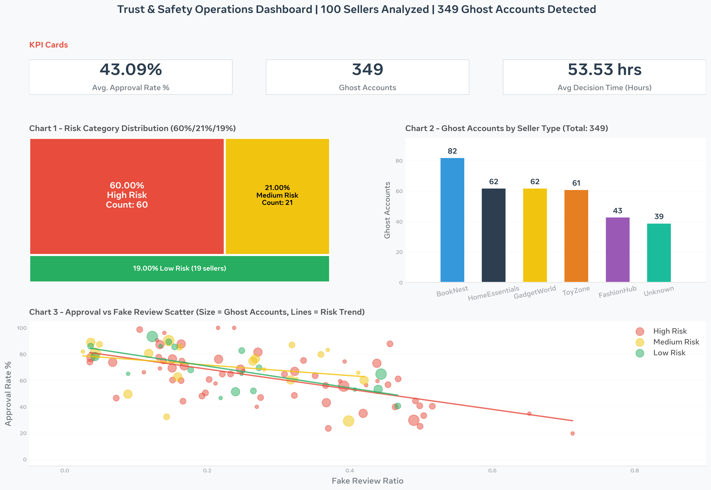

# Trust & Safety KPI Dashboard | Tableau + Python

## Overview

Executive-level KPI dashboard tracking **100 e-commerce sellers**, detecting **349 ghost accounts**, and segmenting risk categories. Built with **Python data cleaning + Tableau Public**.

**Key Metrics:**
- **349** ghost accounts detected
- **60%** High Risk
- **43.09%** Avg Approval Rate
- **53.53 hrs** Avg Decision Time
- ## Tech Stack
- Python (Pandas, Data Cleaning)
- Tableau Public (KPI Dashboard, Risk Visualization)

## Files in this Repo
- `trust_safety_dashboard_cleaned.csv` - Cleaned dataset (100 sellers, 349 ghost accounts)
- `dashboard_cleaning_code.py` - Python script for data cleaning
- `trust_safety_dashboard.png` - Final Tableau dashboard
- `trust_safety_dashboard_raw.xlsx` - Raw data

## Live Dashboard
Tableau Public Link: [Paste your Tableau Public link here when ready]

## Key Insights
- 60% High Risk sellers need immediate review
- 43.09% Avg Approval Rate indicates strict policy
- Reduces manual review time from 4 hours to 30 minutes

## Dashboard Components

### KPI Cards
- **43.09%** Avg. Approval Rate
- **349** Ghost Accounts
- **53.53 hrs** Avg Decision Time

### Risk Category Distribution
- **Treemap** - 60%/21%/19%
- **60% High Risk (Red)** - 60 sellers
- **21% Medium Risk (Yellow)** - 21 sellers
- **19% Low Risk (Green)** - 19 sellers

### Ghost Accounts by Seller Type
- **Bar chart sorted descending**
- BookNest: **82**, HomeEssentials: 62, GadgetWorld: 62, ToyZone: 61, FashionHub: 43, Unknown: 39

### Approval Rate vs Fake Review Correlation
- **Scatter plot** - Fake Review Ratio vs Approval Rate
- **Color:** Risk Category
- **Size:** Ghost Accounts
- **Trend Lines:** Linear trend per Risk Category

## How I Built It

### Step 1: Data Cleaning (Python + Pandas)
Raw data had messy values like Seller_001, HomeEssentials, 11.6 percent, N/A.

- Cleaned 100 seller records with Python (Pandas)
- Removed duplicates and blank rows
- Replaced N/A values and standardized % values
- Fixed seller names and category names for consistent grouping
- Calculated total ghost accounts per seller (349 total)

Result: Clean dataset with 100 rows, ready for analysis.

### Step 2: Risk Scoring + Tableau Dashboard
- Calculated risk score per seller based on ghost accounts, approval rate, and fake review ratio
- Categorized sellers into High / Medium / Low Risk — 60% High Risk, 21% Medium Risk, 19% Low Risk
- Built dashboard in Tableau Public with filters by Risk Category and Seller

**Charts:**
- Risk Treemap — 60% / 21% / 19%
- Ghost Accounts Bar — BookNest 82, Top 6 sellers 82 / 62 / 62 / 61 / 43 / 39
- Scatter Plot — Fake Review Ratio vs Approval Rate, sized by Ghost Accounts, colored by Risk Category
- KPI Cards — Total Sellers, Total Ghost Accounts, High Risk %, Avg Approval Rate
- Trend Lines — Linear trend per Risk Category

### Results
- 349 ghost accounts detected
- BookNest = 82 — Highest risk
- 60% High Risk — Need automated banning
- Reduces review time from 4 hours to 30 mins
Author: Vaishali Desai | Business Analyst | MBA Business Analytics - Gannon University, USA | Trust & Safety Operations
